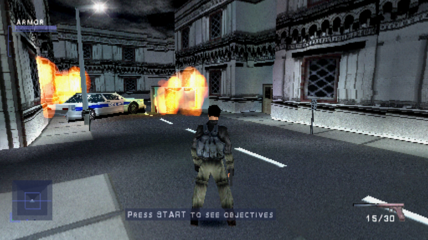
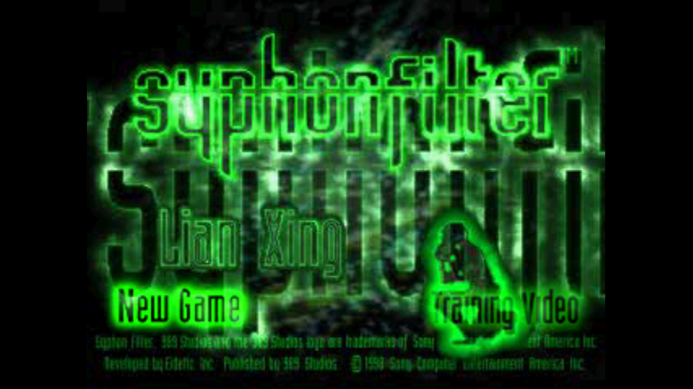
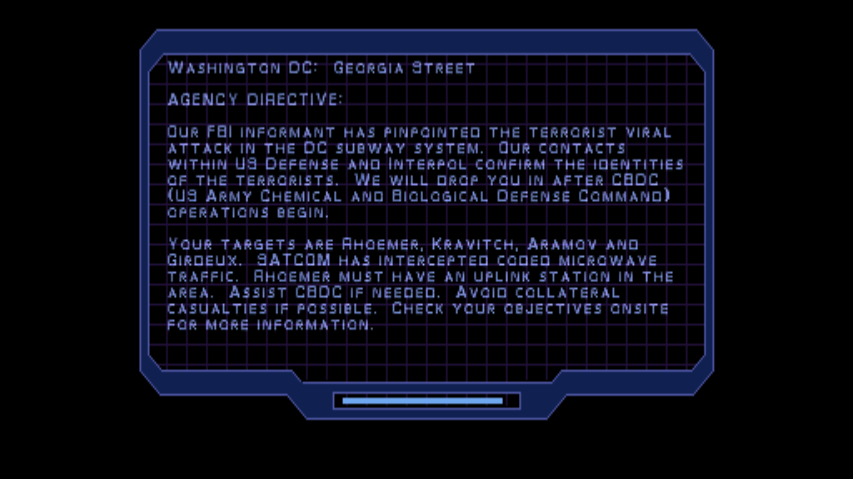
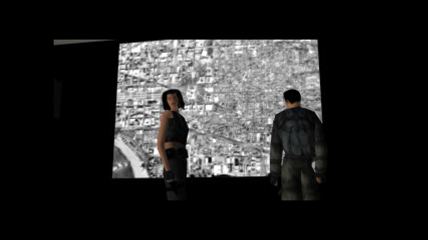
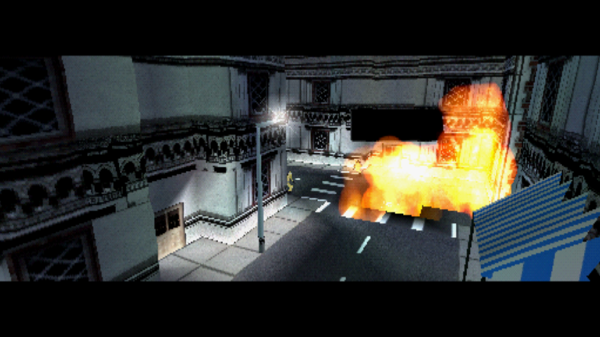
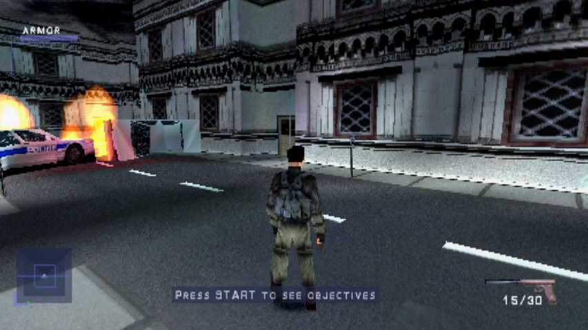
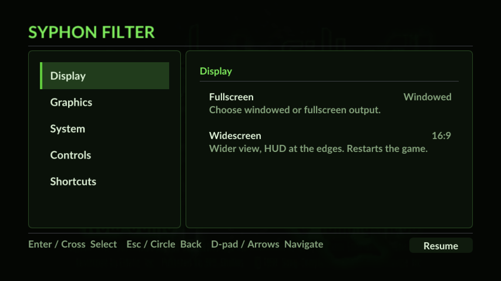
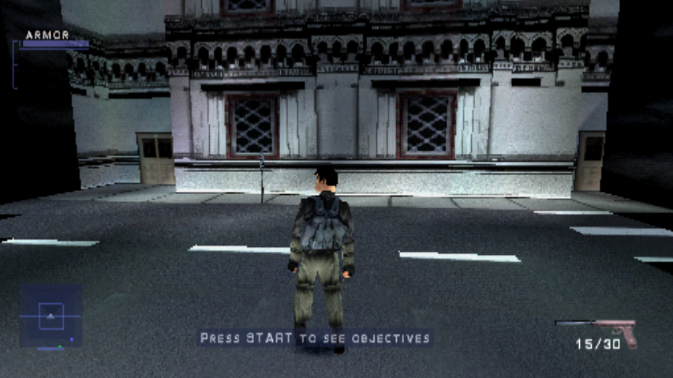
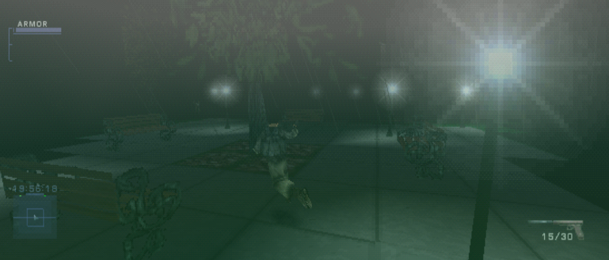
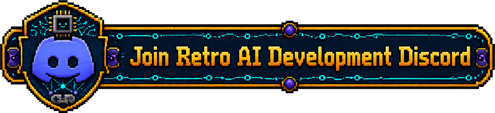

# Syphon Filter Recompiled

**Syphon Filter (1999, PlayStation) running as a native PC program, in widescreen.** The game's MIPS code is statically recompiled to C and runs natively on [psxrecomp](https://github.com/mstan/psxrecomp), a model of the PlayStation hardware.

> **No game data here.** You need your own disc image of Syphon Filter (USA, `SCUS-94240`). The recompiled C is generated from your disc, on your machine, at build time. It is never committed or distributed, and neither is anything else derived from the disc.

<p align="center">
  
</p>

## Screenshots

Real frames from the recompiled build, in 16:9:

| | |
|---|---|
|  |  |
|  |  |
|  |  |

The same spot in 4:3, the original view, and in 16:9:

| 4:3 | 16:9 |
|---|---|
|  |  |

And in 21:9:

<p align="center">
  
</p>

## Why

Syphon Filter is one of the PlayStation's best action games, and it still runs, at best, inside an emulator built for a 4:3 CRT. A static recompilation turns the game into a regular program: it can be changed, fixed and extended like any other code. Widescreen was the first thing that needed it.

## Status

Alpha.

- Boots on the bundled OpenBIOS, plays the intro FMV, the title menu, the mission briefings and the first mission, Georgia Street, on recompiled code.
- **Widescreen** (16:9, 21:9 or adaptive, off by default):
  - native-wide: the wider field of view is rendered into a wider frame, not squashed and stretched;
  - the HUD moves to the edges of the wide frame: armor and radar to the left, ammo and weapon to the right;
  - FMVs, briefings, the pause map and the title menu keep their 4:3 pillarbox;
  - checked on Georgia Street (opening flyover, a full turn, a walk down the street) and in the attract demo. Later missions have not been checked yet.
- **In-game menu** (Esc or F10, Select + L3 on a pad): fullscreen, widescreen, HD textures, internal resolution, a controls chart with your keyboard binds and the PlayStation button for each of Gabe's actions, and the recomp's shortcuts (save states, fast forward, FPS counter).
- **HD texture packs** in DuckStation's format, from the menu.

## What was done

Syphon Filter runs on [psxrecomp](https://github.com/mstan/psxrecomp), with its launcher and menu from [recomp-ui](https://github.com/RetroPortingToolKit/recomp-ui). This repo uses forks of both ([psxrecomp](https://github.com/danilopaulinodasilva/psxrecomp/tree/syphon-filter), [recomp-ui](https://github.com/danilopaulinodasilva/recomp-ui/tree/feat/psx-menu-title-items)) until the changes are merged upstream. Bringing it up took:

- **A boot fix**: after a seek, the game's FMV task waits for the drive to report a plain "seeking" status, but the runtime always reported "reading", so it seeked forever on a black screen. The fork adds a `cd_seek_sets_read` option and this game turns it off.
- **Widescreen**, which the game never had:
  - Syphon Filter keeps screen X centred and drops objects and polygons by how far they are from the centre. Those tests are widened at the sites listed in `game.toml`;
  - the world renderer flags every vertex past a limit it computes once per frame, which drew black wedges at the wide edges; the plugin widens that limit where it is stored;
  - the HUD is anchored per packet by a plugin (`src/mods/sf_widescreen_plugin.c`) that hooks the HUD's draw routines, so strings and icons move as one piece and full-screen effects stay put.
- **The menu rows** (`src/menu/sf_menu.cpp`): widescreen and HD textures go through the mod catalogue, and the game restarts when they change.

[docs/WIDESCREEN.md](docs/WIDESCREEN.md) has the details, with every site and the open items.

## Roadmap

1. **Widescreen in every mission**: play past Georgia Street and check the HUD and the edges in each level, including boss bars, timers and special weapons.
2. **The changes upstream**: send the boot fix, the cull hooks and the menu rows to psxrecomp and recomp-ui, so the forks can go.
3. **More in the menu**: CRT shaders, gamepad remapping and difficulty.
4. **Syphon Filter 2 and 3**, the same way.

## Help wanted

This is a hobby project and help is very welcome. Useful things, roughly from easiest:

- **Play it and report problems**: which mission, what you did, what you expected, and a screenshot. Widescreen in the later missions is the most useful thing to check.
- **Test the build on Windows and Linux.** It has been built and played on macOS so far.
- **Reverse engineering**: HUD pieces and visibility tests the widescreen plugin doesn't know yet.

## Building

**Prerequisites:** Git, CMake 3.20+, Ninja, pkg-config, Python 3, and a C/C++ compiler (Xcode command-line tools on macOS, GCC or Clang on Linux, MSYS2 MinGW-w64 on Windows). SDL3 is fetched if the system doesn't have it. [psxrecomp's BUILDING.md](https://github.com/mstan/psxrecomp/blob/master/docs/BUILDING.md) has the details.

1. **Clone with the submodules:**
   ```
   git clone --recurse-submodules https://github.com/danilopaulinodasilva/SyphonFilterRecomp
   cd SyphonFilterRecomp
   ```
2. **Build the recompiler:**
   ```
   ./psxrecomp/tools/ci/build_emitters.sh
   ```
3. **Recompile your disc into `generated/`.** You need a dump of Syphon Filter (USA), `.cue` + `.bin`; the data track's checksums are in `game.toml`.
   ```
   python3 psxrecomp/psxrecomp_cli.py generate \
     --config game.toml --project-root . --disc "path/to/Syphon Filter (USA).cue"
   ```
4. **Build the game:**
   ```
   cmake -S . -B build-release -G Ninja -DCMAKE_BUILD_TYPE=Release
   cmake --build build-release --target psx-runtime
   ```
5. **Play:** run `build-release/SyphonFilter_Recompiled` and point the launcher at your `.cue` the first time.

`generated/` is ignored by git: never commit it, or anything else made from the disc.

## Controls

The game's own layout ("Configuration A") on the keyboard or a pad. The menu's **Controls** page lists your keyboard binds, which you can change in the launcher.

| Action | Pad |
|---|---|
| Move | D-pad, left stick |
| Fire, throw a grenade | Square |
| Crouch, take cover | Cross |
| Roll | Circle |
| Use, climb, reload, radio | Triangle |
| Lock on / next target | R1 |
| Manual aim | L1 |
| Strafe / lean | L2, R2 |
| Weapons (hold, then L2 / R2) | Select |
| Pause, map, objectives | Start |

**Esc** or **F10** opens the in-game menu (Select + L3 on a pad), and Select + R1 opens save states.

## Legal

You must own the original game. Disc images go under `disc/` or anywhere outside the repo, and are gitignored. No retail BIOS is needed: the game runs on the bundled MIT [OpenBIOS](https://github.com/grumpycoders/pcsx-redux/tree/main/src/mips/openbios); a retail dump is optional and stays on your machine.

Syphon Filter is a trademark of Sony Interactive Entertainment. This project is not affiliated with Sony, Eidetic or Bend Studio.

The code in this repo is MIT ([LICENSE](LICENSE)). Optional box art under `launcher_assets/img/` comes from [libretro-thumbnails](https://github.com/libretro-thumbnails/libretro-thumbnails) (`BOXART_SOURCE.txt`).

<!-- retcomm-readme-raid -->
---

<p align="center">
  <sub><b>R.A.I.D. — Retro AI Development</b> · a Discord for AI-assisted retro reverse-engineering, decomp &amp; recomp</sub>
</p>

<p align="center">
  <a href="https://discord.gg/Ad9BwSzctP"></a>
</p>
<!-- /retcomm-readme-raid -->
